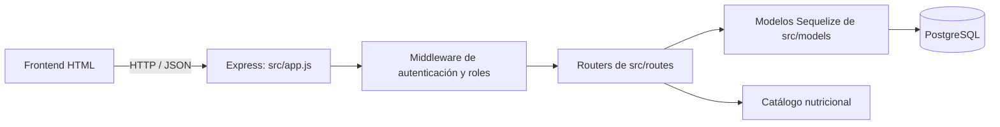
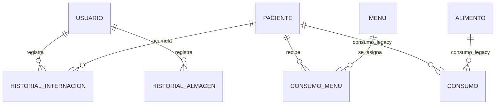

# Arquitectura del backend

## Vista general

El backend es una aplicación Node.js con Express y Sequelize. Express recibe las peticiones HTTP, los routers validan la operación y la sesión, los modelos Sequelize representan los datos y PostgreSQL los persiste.



## Estructura

```text
backend/
  src/
    app.js                  Configuración de Express, relaciones y montaje de routers
    config/database.js      Conexión a PostgreSQL y carga de backend/.env
    middleware/auth.js      Tokens de sesión y autorización por rol
    controllers/            Lógica de autenticación y operaciones de cada módulo
    models/                 Entidades y tablas Sequelize
    routes/                 Endpoints agrupados por área funcional
    utils/
      nutritionCatalog.js   Opciones controladas de patologías, dietas y comidas
      password.js           Hash y verificación de contraseñas
  test/                     Pruebas automatizadas de seguridad
  docs/architecture.md      Este documento
```

## Relaciones de datos

`ConsumoMenu` es la entidad de asignación. Cada registro conecta un paciente con un menú para una fecha y comida. Un acompañante añade una porción calculada al guardar la asignación.



Campos importantes de `consumos_menu`:

- `pacienteId` y `menuId`: claves foráneas obligatorias.
- `fecha` y `comida`: momento del servicio.
- `porciones_paciente`: normalmente una porción.
- `porciones_acompanante`: una porción adicional cuando el paciente tiene acompañante.
- Una restricción única por `pacienteId`, `fecha` y `comida` evita asignaciones duplicadas; una nueva asignación actualiza la existente.

`menus` guarda nombre, dieta, composición y estado activo. La aplicación valida que la dieta del menú coincida con la indicada para el paciente. La patología no selecciona automáticamente una dieta; esa decisión corresponde a Nutrición.

`consumos` y `Alimento` pertenecen al flujo anterior de consumo de stock. La ruta `POST /api/alimentos/consumo` devuelve `410 Gone`: el flujo vigente es la planificación por menús y no descuenta gramos automáticamente.

## Flujo de una petición

1. `src/app.js` carga variables de entorno, crea Express, declara asociaciones y monta cada router bajo `/api`.
2. Los routers funcionales pasan por `requireAuth`; las operaciones de escritura agregan `allowRoles` según el perfil.
3. Las rutas asocian cada método y URL con el controlador correspondiente; los controladores validan la petición y usan modelos Sequelize.
4. Las operaciones que deben mantenerse consistentes, como asignaciones o cambios de internación, usan transacciones.
5. Sequelize convierte las operaciones a consultas PostgreSQL y devuelve el resultado al cliente como JSON.

## Autenticación y roles

- `POST /api/auth/registrar` requiere `STAFF_REGISTRATION_KEY` y limita los roles a Enfermera, Nutricionista y Cocinera.
- `POST /api/auth/login` verifica la contraseña y entrega un token firmado con vencimiento de ocho horas.
- Las contraseñas nuevas usan `scrypt`; contraseñas antiguas en texto plano se convierten al formato hash cuando el usuario inicia sesión correctamente.
- Las rutas privadas esperan `Authorization: Bearer <token>`.
- Nutricionista crea menús; Enfermera y Nutricionista administran pacientes, internaciones, stock y asignaciones. Cocina consulta el panel y el resumen.
- `SESSION_SECRET` y `STAFF_REGISTRATION_KEY` son variables privadas de `backend/.env`; no se documentan sus valores ni se sube ese archivo al repositorio.
- Login y registro aplican límites de intentos por IP. El almacenamiento predeterminado es local al proceso; despliegues con varias instancias requieren un almacén compartido.
- El backend exige `SESSION_SECRET` de al menos 32 bytes y rechaza el valor de ejemplo. La clave de registro también debe ser privada y tener al menos 32 caracteres.

## Routers principales

| Prefijo | Responsabilidad |
| --- | --- |
| `/api/auth` | Registro de personal e inicio de sesión |
| `/api/pacientes` | Consulta, alta, alta médica, reingreso y consumos históricos |
| `/api/historial-pacientes` | Historial de internaciones y altas |
| `/api/alimentos` | Consulta e ingreso de stock; la ruta antigua de consumo responde 410 |
| `/api/menus` | Catálogo clínico, menús, asignaciones y cantidades para cocina |

Endpoints del módulo de menús:

| Método y ruta | Función |
| --- | --- |
| `GET /api/menus/opciones` | Catálogo de patologías, dietas y comidas |
| `GET /api/menus` | Lista menús activos; acepta `?dieta=` |
| `POST /api/menus` | Crea un menú (Nutricionista) |
| `GET /api/menus/asignaciones?fecha=AAAA-MM-DD` | Lista asignaciones del día |
| `POST /api/menus/asignaciones` | Crea o actualiza una asignación por paciente, fecha y comida |
| `GET /api/menus/resumen?fecha=AAAA-MM-DD` | Agrupa por comida, dieta y menú; calcula porciones de pacientes, acompañantes y total |

## Configuración y ejecución

Las variables se leen desde `backend/.env`. Se usan `PORT`, configuración de PostgreSQL (`DB_NAME`, `DB_USER`, `DB_PASSWORD`, `DB_HOST`, `DB_PORT`) y secretos de sesión/registro. No copies valores secretos a este documento.

Desde la carpeta del backend:

```powershell
npm start
```

Las pruebas automatizadas se ejecutan con:

```powershell
npm test
```

## Sincronización del esquema

Al iniciar, Umzug aplica las migraciones versionadas de `src/migrations` y registra sus nombres en `SequelizeMeta`; el servidor no ejecuta `sequelize.sync({ alter: true })`. La migración inicial crea las tablas ausentes de forma idempotente y la siguiente elimina una restricción única obsoleta de `consumos`. Los cambios futuros deben añadirse como migraciones nuevas y respaldarse antes de aplicarlos. La conexión configurada con `DATABASE_URL` valida certificados TLS; para una CA privada, proporciona el PEM en `DB_SSL_CA`.
